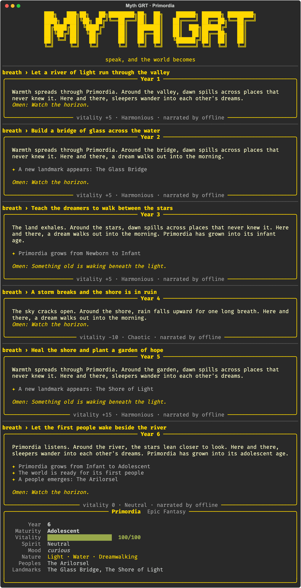
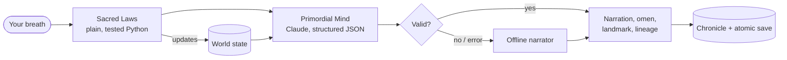

# Myth GRT

**Speak, and the world becomes.** A world-simulation game where every sentence you type reshapes a living world, and Claude narrates how it answers.

[](https://github.com/NovaBlessed/Myth-GRT-AI-World-Simulation/actions/workflows/tests.yml)


<p align="center">
  
</p>

*Screenshot recorded in offline mode (`--offline`), which uses built-in template narration. With an Anthropic API key, every turn is narrated by Claude.*

---

## How it plays

You are the **Architect**. You start by shaping a world's **Sacred Genesis**: a genre (Epic Fantasy, Horror, Comedy, Sci-Fi, and more), two elements, and up to two phenomena such as Dreamwalking or Time Distortion. Then you **breathe**: type any sentence of intent.

```text
breath › Build a bridge of glass across the water
breath › A storm breaks and the shore is in ruin
breath › Let the first people wake beside the river
```

Each breath ages the world a year. Kind words heal it, cruel ones wound it, and ignoring its nature lets strange things emerge on their own. As it grows from Newborn to Ancient, the world raises landmarks and gives rise to its first people. Everything you say is written permanently into its history.

## How a turn works



The core design choice: **the laws decide what happens; the AI decides how it's told.** Game rules live in deterministic code, so the simulation stays consistent no matter what the model writes. Claude receives the world state and the laws' verdict, then returns narration in a strict JSON schema that is validated before it touches the world.

## The Sacred Laws

| Law | What it does |
|---|---|
| **Time** | Every breath is one year. |
| **Resonance** | Words of creation raise vitality; words of destruction lower it. Some genres hear words differently (in a Drama, *love* is bittersweet). |
| **Attention** | Breaths that ignore the world's elements and phenomena build up neglect. After three, a phenomenon emerges on its own. |
| **Becoming** | Worlds mature: Newborn → Infant → Adolescent → Mature → Ancient. |
| **Lineage** | When a world reaches adolescence, its first people are born, named, and given a purpose. |
| **Balance** | Vitality can run out. A world below 20 begins to wither. |
| **Irreversibility** | Every breath is saved to history and can't be undone. |

## Quick start

```bash
git clone https://github.com/NovaBlessed/Myth-GRT-AI-World-Simulation.git
cd Myth-GRT-AI-World-Simulation
pip install -e .

cp .env.example .env      # add your ANTHROPIC_API_KEY
myth-grt play             # create a world and start breathing
```

No API key? Play right away with offline narration:

```bash
myth-grt play --offline
```

## Commands

| Command | What it does |
|---|---|
| `myth-grt play` | Play. Creates a world on first run, then picks up where you left off. |
| `myth-grt play --new` | Start a new world. |
| `myth-grt status` | Show a world's current state. |
| `myth-grt chronicle --out story.md` | Export the world's whole history as a Markdown story. |
| `myth-grt demo --offline "breath one" "breath two"` | Play a scripted session (add `--svg file.svg` to record it). |

Inside the game, type `/status`, `/chronicle`, `/help`, or `/exit`.

**Configuration** (in `.env`): `ANTHROPIC_API_KEY` (required for Claude narration), `MYTH_GRT_MODEL` (default `claude-opus-5-5`), and `MYTH_GRT_EFFORT` (default `medium`).

## Under the hood

- **Structured output.** Claude returns `narration`, `omen`, `landmark`, `lineage_name`, and `lineage_purpose` against a JSON schema. Responses are length-checked and trimmed before use.
- **Graceful failure.** Refusals, cut-off responses, invalid JSON, rate limits, and network errors raise a `MindError`. That breath is then narrated offline, with a note, so the game never stops.
- **Refusal fallback.** Requests opt into Anthropic's server-side fallback (`fallbacks: "default"`).
- **Deterministic offline mode.** The same world and the same breath always produce the same story, which makes it ideal for tests and demos.
- **Safe saves.** Worlds are written atomically (temp file plus rename), and save files from the original 2025 version are migrated automatically.

```text
myth_grt/
  world.py      World model, genesis options, atomic save/load, v1 migration
  laws.py       The Sacred Laws (pure functions)
  mind.py       ClaudeMind (structured output) and OfflineMind
  engine.py     One turn: laws → narration → landmarks/lineage → history
  chronicle.py  Markdown export
  cli.py        Rich terminal interface
tests/          33 tests; the Claude client is faked, so tests never call the API
```

## Tests

```bash
pip install -e ".[dev]"
pytest
```

GitHub Actions runs the suite on Python 3.10, 3.12, and 3.13 for every push.

## What changed in 2.0

Version 1 (May 2025) was a two-file prototype. Version 2 is a rebuild:

- **New structure.** It's now a package with a command line, tests, and CI.
- **Lineages work.** World maturity now advances, so lineages actually appear (in v1 they never could).
- **Genesis matters.** Your chosen elements and phenomena now shape every narration.
- **Leaner AI calls.** One structured Claude call per breath, instead of two free-text calls to a retired model.
- **Safer input and saves.** Input is validated at genesis, and saves are atomic.
- **Offline play.** You can play with no API key at all.

---

Created by **Marc “Nova” Jenkins**: game design, AI architecture, and engineering. [Portfolio](https://marc-nova-jenkins.vercel.app)
